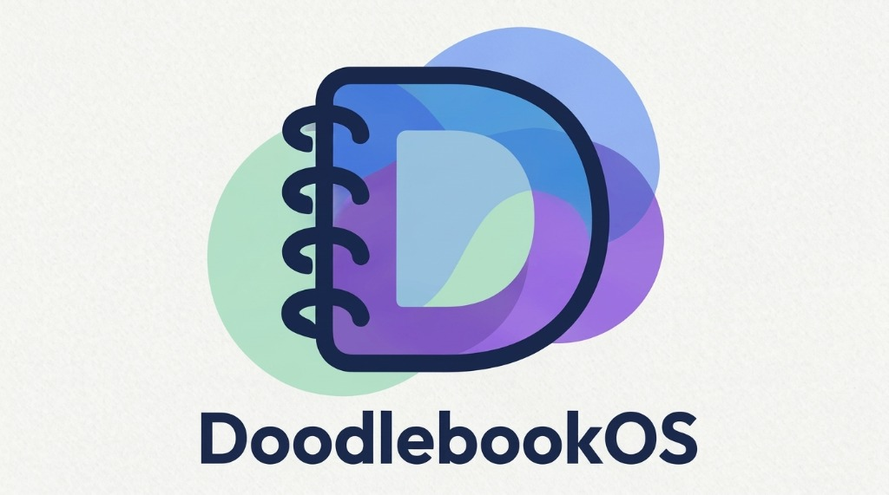
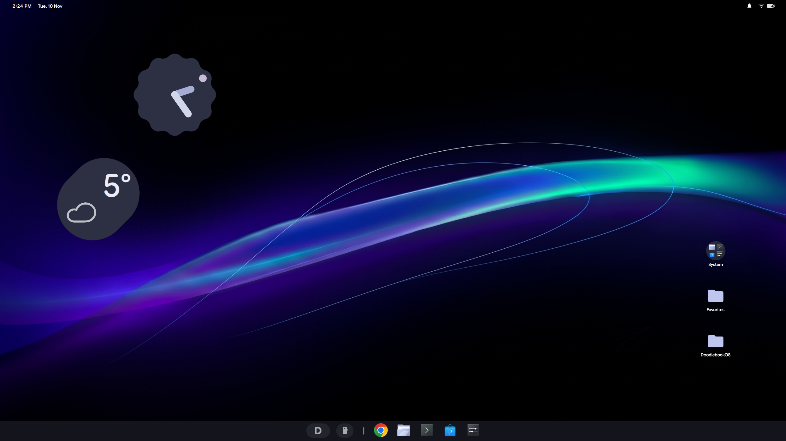
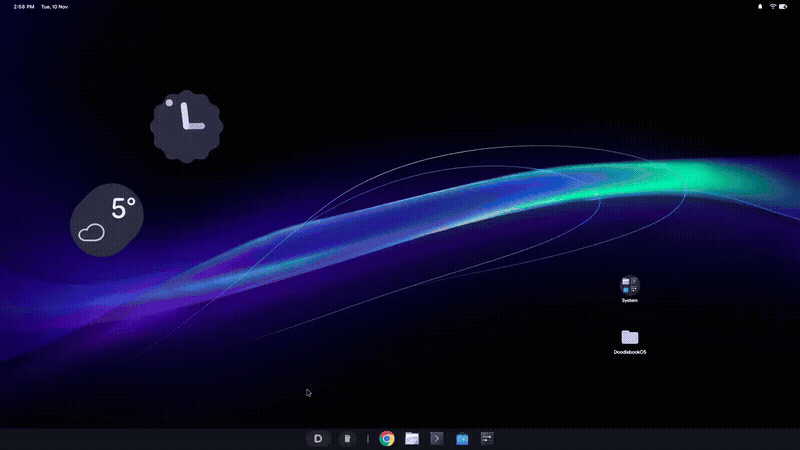
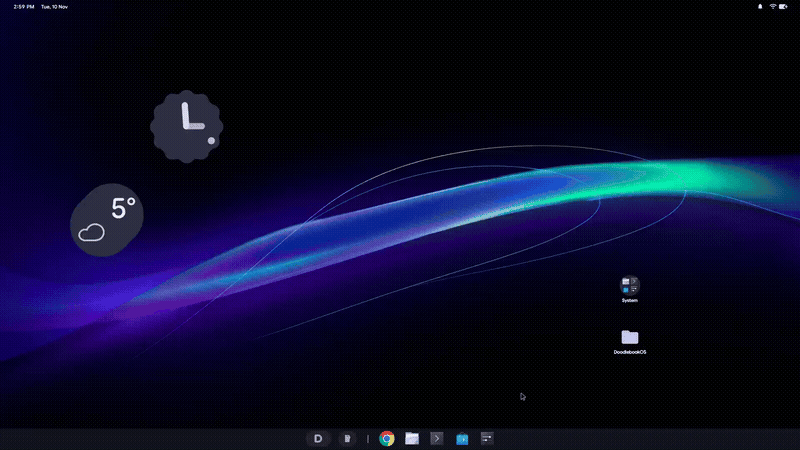
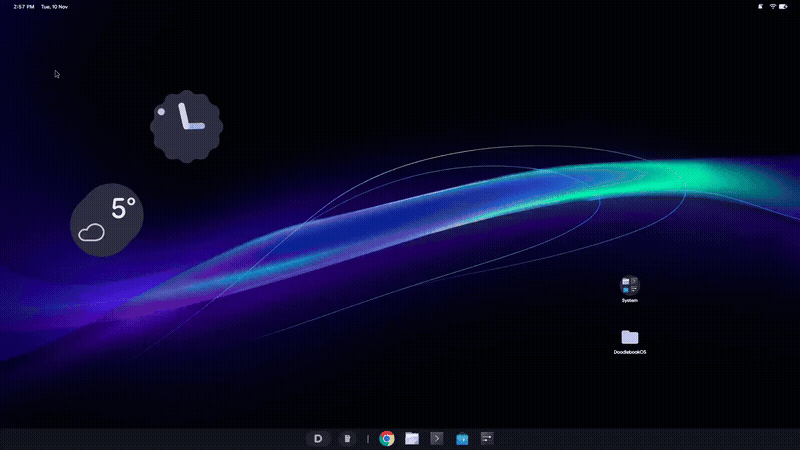
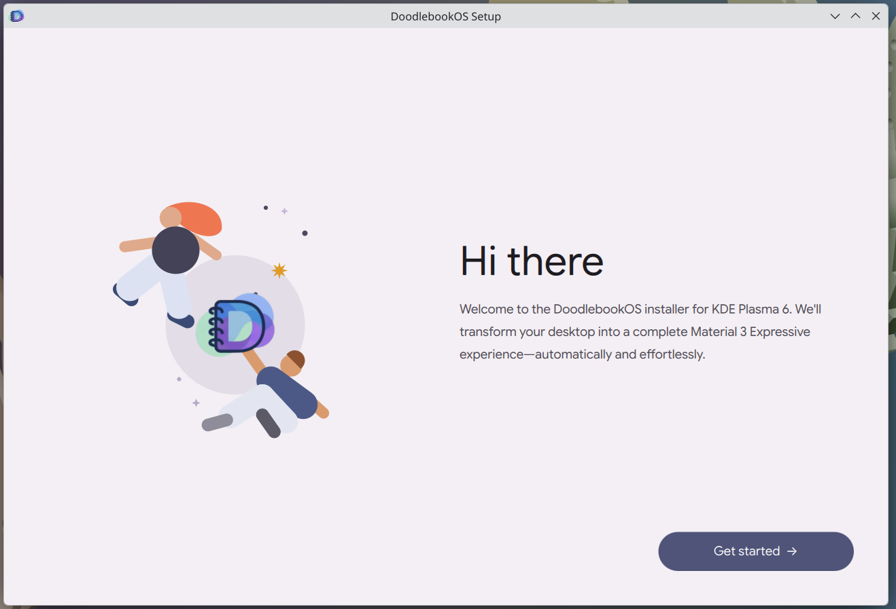
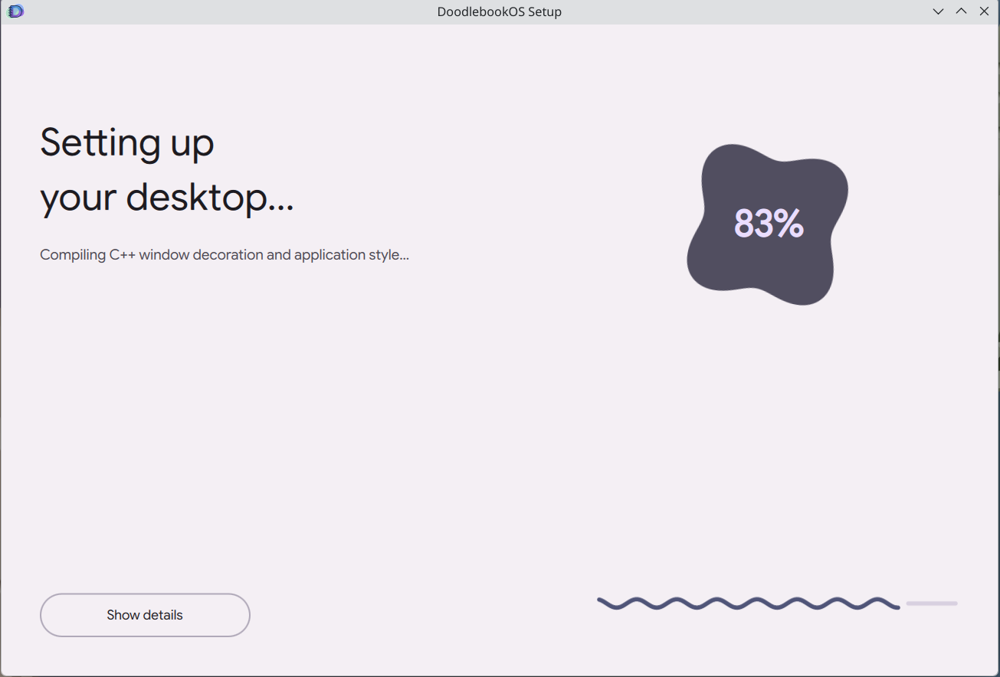

<p align="center">
  
</p>

<h3 align="center">Material 3 Expressive Desktop Suite for KDE Plasma 6</h3>

<p align="center">
  <a href="LICENSE"></a>
  <a href="https://kde.org"></a>
  <a href="https://wayland.freedesktop.org"></a>
  <a href="https://ko-fi.com/panoptikuum"></a>
</p>

**DoodlebookOS** is a comprehensive Material 3 Expressive desktop environment suite crafted natively for **KDE Plasma 6 on Wayland**. It recreates the clean, unified Android PC / Googlebook desktop experience featuring custom QML plasmoids, native C++ application styles and window decorations, real-time wallpaper contrast adaptation, dedicated icon personalizers, and a guided graphical setup wizard.

<p align="center">
  
</p>

### Live Demonstrations & Showcase

| Application Launcher | Quick Settings Drawer |
| :---: | :---: |
|  |  |

| Desktop Application Folders | Single-Column Calendar |
| :---: | :---: |
|  |  |

| OOBE Setup Wizard (Welcome) | OOBE Setup Wizard (Compiling) |
| :---: | :---: |
|  |  |

---

## Supported Platforms & System Requirements

To ensure a flawless experience, please review the system prerequisites before running the installer:

| Requirement | Specification | Notes |
| :--- | :--- | :--- |
| **Desktop Environment** | **KDE Plasma 6.0+** | **Plasma 5 is not supported** (Plasma 6 / Qt6 / KF6 architecture is required). |
| **Display Server** | **Wayland** | **Wayland session is required**. X11 is not supported due to Wayland layer-shell popups, input region anchoring, and fractional scaling. |
| **Primary Platform (Tier 1)** | **Fedora 40 / 41+ KDE Spin** | Fully developed, tested, and verified reference environment. |
| **Compatible Platforms (Tier 2)** | **Arch Linux**, **CachyOS**, **EndeavourOS**, **openSUSE Tumbleweed**, **Ubuntu 24.10+ / KDE Neon** | Supported with automatic dependency resolution. *(Note: Ubuntu 24.04 LTS is not supported as it ships with Plasma 5.27).* |

---

## What the Installer Does & System Permissions

We believe in complete transparency. Here is exactly what the installer does on your computer and why:

### 1. Administrator Privileges (`sudo` / `pkexec`)
Administrator privileges are requested during the prerequisite phase only for:
- **System Build & Runtime Dependencies:** Installs required development packages (`cmake`, `ninja`, Qt6/KF6 compilation headers, `python3-pyside6`, `python3-pillow`) through your distribution's native package manager (`dnf`, `pacman`, `apt-get`, or `zypper`).
- **Klipper Clipboard Override:** Backs up `/usr/lib64/qt6/qml/org/kde/plasma/private/clipboard/KlipperPopup.qml` to `.orig` and installs the Material 3 masonry clipboard popup override (`Meta+V`).

### 2. User-Space Installation (`~/.local/`)
All core components are compiled and installed strictly in your user space, with **zero pollution of root directories**:
- **Plasmoids & Containments:** Installed into `~/.local/share/plasma/plasmoids/`.
- **C++ Native Plugins:** Compiled via `cmake` and installed into `~/.local/lib64/` (Application Style `doodlebookos6.so`, Window Decoration `org.doodlebookos.decoration.so`, and Applet bindings).
- **Themes & Assets:** Installed into `~/.local/share/` (Plasma desktop themes, color schemes, cursors, fonts, wallpapers).
- **Desktop Tools:** `Icon Studio` installed to `~/.local/bin/doodlebook-icon-studio`.

### 3. Automated Configuration Backup
Before any panel layout or theme configuration is altered, the installer creates an automatic snapshot of your existing KDE configuration in:
```
~/.config/doodlebookos-backups/latest
```
You can restore your original desktop configuration at any time by running `./uninstall.sh`.

---

## Display Scaling & Multi-Monitor Behavior

### Multi-Monitor Setups
DoodlebookOS is architected to deliver a streamlined, distraction-free desktop experience:
- **Primary Display (`screen 0`):** Anchors the unified Top Bar (DateTime & Status Cluster) and the centered bottom Shelf Dock.
- **Secondary Displays:** Function as clean, uncluttered expanded workspaces displaying your synchronized wallpaper and desktop widgets.

### Automatic Display Scaling
The installer reads your display EDID and physical metrics via `kscreen-doctor` to calculate optimal Wayland fractional scaling (1.0×, 1.25×, 1.5×, 1.75×, or 2.0×) and enables integer-crisp scaling for legacy XWayland clients.

---

## Key Features

- **Unified Top Bar (`32 dp`):**
  - **DateTime (`org.doodlebookos.datetime`):** Top-left pill featuring clean typography and a single-column Material You monthly calendar popup.
  - **StatusCluster (`org.doodlebookos.statuscluster`):** Top-right status pill integrating media controls, notification center (`org.freedesktop.Notifications`), and an Android-style Quick Settings drawer (Wi-Fi, Bluetooth, Dark Mode, Battery Saver, Mic mute, Screenshot, Quick Share).
  - **Adaptive Wallpaper Contrast (`doodlebookos-topbar-color`):** Background daemon that analyzes the wallpaper luminance directly behind top bar pills and dynamically adjusts foreground contrast (dark vs. light text and icons).
- **Material 3 Shelf Dock (`52 dp`):**
  - **Dock (`org.doodlebookos.dock`):** Centered application shelf with live window indicators, pin management, a full-screen Material You launcher (`Meta`), and a KDE Connect **Phone Hub** integration.
- **Material 3 Desktop Widgets:**
  - **Clock:** 12-sided cookie analog clock (`220×220 dp`).
  - **Weather:** Open-Meteo live weather widget with automatic IP geolocation (`220×220 dp`).
  - **AppGroup:** Desktop application folder bubbles with live item previews (`90×100 dp`).
  - **Desktop Containment (`org.kde.desktopcontainment`):** Simplified right-click menu with a live wallpaper carousel.
- **Native Tools & System Overrides:**
  - **Icon Studio (`doodlebook-icon-studio`):** Dedicated PySide6 / QML tool for personalizing application, PWA, and launcher icons.
  - **Material 3 Masonry Clipboard:** System clipboard popup (`Meta+V`) with full rich-text, image preview, and pin management.
- **Native Themes & Window Styling:**
  - Custom Qt6/KF6 application style (`DoodlebookOS`) with smooth hover animations.
  - Native KDecoration3 C++ window decoration (`org.doodlebookos.decoration`).
  - Google Sans Flex variable typography and dual color schemes (`DoodlebookOS_LIGHT` and `DoodlebookOS_DARK`).

---

## Installation

### 1. Graphical Setup Wizard (Recommended)

Clone the repository and run the guided OOBE installer:

```bash
git clone https://github.com/PanOptikuum/DoodlebookOS.git
cd DoodlebookOS
chmod +x install-gui.sh
./install-gui.sh
```

Alternatively, double-click `DoodlebookOS-Installer.desktop` in your file manager.

### 2. Command-Line Installer

For headless or automated installations:

```bash
git clone https://github.com/PanOptikuum/DoodlebookOS.git
cd DoodlebookOS
chmod +x install.sh
./install.sh
```

---

## Switching Dark & Light Mode

You can toggle between Dark and Light mode at any time using the Quick Settings **Dark theme** tile in the top-right Status Cluster, or via the command line:

```bash
~/.local/bin/dostheme toggle   # Toggle between Dark and Light mode
~/.local/bin/dostheme dark     # Switch to DoodlebookOS Dark
~/.local/bin/dostheme light    # Switch to DoodlebookOS Light
```

---

## Uninstallation & Restoring Backups

To completely remove DoodlebookOS and restore your previous KDE Plasma panels, themes, and configuration:

```bash
./uninstall.sh
```

The uninstaller will:
1. Stop and disable background daemons (`doodlebookos-topbar.service`).
2. Restore your original system clipboard files from `.orig` backups.
3. Remove user-space plasmoids, C++ libraries, themes, and icons.
4. Restore your previous KDE configuration from `~/.config/doodlebookos-backups/latest`.
5. Restart Plasma Shell to return you directly to your previous desktop.

---

## Roadmap to Beta (v1.0)

- [ ] **Multi-monitor independent panels:** Independent per-monitor panel replication and configuration.
- [ ] **Expanded desktop widget ecosystem:** UpNext agenda widget and native Material 3 system resource monitor.
- [ ] **KDE System Settings KCM:** Dedicated graphical configuration module integrated directly into KDE System Settings.
- [ ] **Package repository distribution:** Official AUR (Arch) and COPR (Fedora) packages.

---

## Support & Community

If you enjoy DoodlebookOS and want to support its ongoing development, consider buying me a coffee!

[](https://ko-fi.com/panoptikuum)

- **Discussions & Ideas:** Join the conversation in [GitHub Discussions](https://github.com/PanOptikuum/DoodlebookOS/discussions).
- **Bug Reports:** Report issues using our [Issue Templates](https://github.com/PanOptikuum/DoodlebookOS/issues).

---

## Repository Structure

- [`widgets/`](widgets/README.md) — 8 custom KDE Plasma 6 QML applets and desktop containment
- [`themes/`](themes/README.md) — C++ application style, KDecoration3 window decoration, Plasma styles, and Global Look-and-Feel
- [`system-overrides/`](system-overrides/README.md) — KRunner DBus bridge and Klipper masonry clipboard override
- [`extras/`](extras/README.md) — Cursors, Google Sans Flex font, wallpapers, and background contrast daemons
- [`tools/`](tools/icon-studio/README.md) — Icon Studio personalizer
- `installer/` — PySide6 & QML graphical installer wizard and installation backend

---

## License

- **DoodlebookOS Code, Applets & Themes:** Licensed under the [GNU General Public License v3.0 or later](LICENSE).
- **Fonts (`Google Sans Flex`):** Licensed under the [SIL Open Font License 1.1](extras/fonts/GoogleSansFlex/OFL.txt).

---

## Disclaimer

DoodlebookOS is an independent open-source project and is not affiliated with, sponsored, or endorsed by Google LLC. ChromeOS, Pixel, Android, and Material You / Material Design are trademarks of Google LLC.
